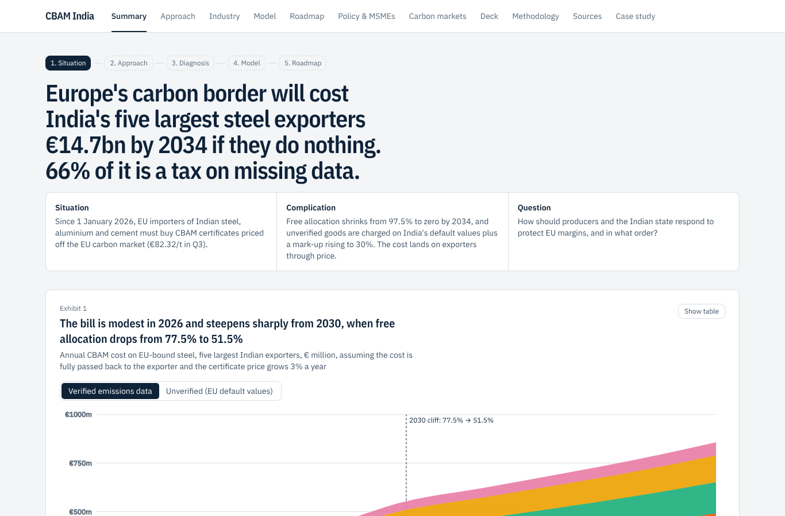
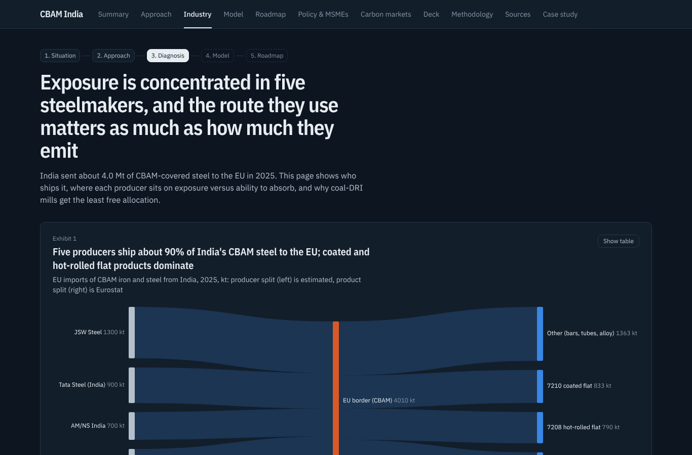
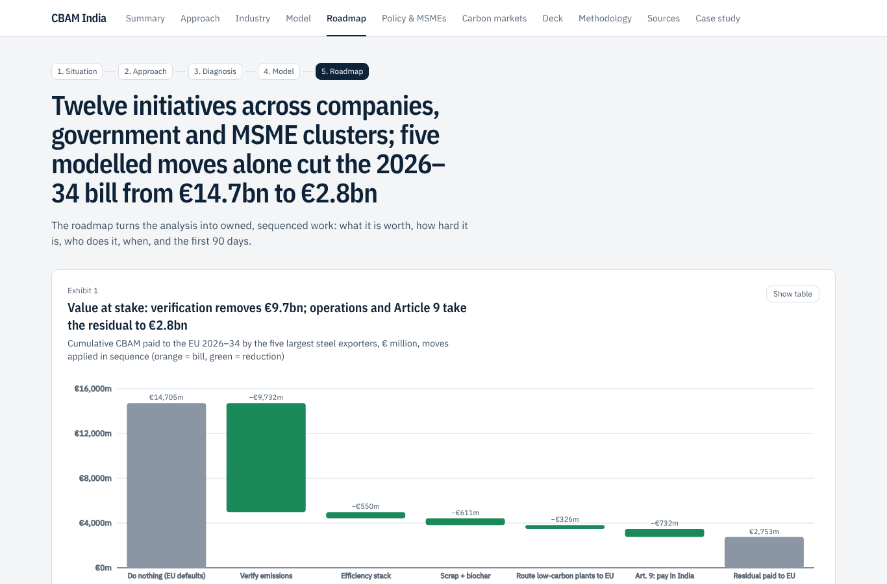
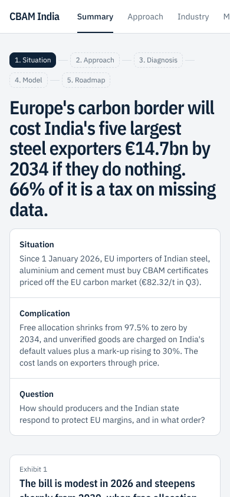

# CBAM India: Carbon Border Exposure Model

Live: https://cbam-india.vercel.app · [Case study](https://cbam-india.vercel.app/case-study) · [One-page PDF](https://cbam-india.vercel.app/CBAM-India-one-pager.pdf) · [Excel model](https://cbam-india.vercel.app/cbam-india-model.xlsx)



**Which Indian steelmakers lose as Europe prices carbon, and what should they do about it?**

An interactive scenario model of the EU Carbon Border Adjustment Mechanism (definitive regime since 1 Jan 2026) for Indian **steel** (JSW, Tata Steel, AM/NS India, JSPL, SAIL) and **aluminium** (Vedanta, Hindalco, NALCO) exporters, with **cement** (UltraTech, Shree, Dalmia) as a contrast case. It covers:

- **Cost bridge**: embedded emissions → benchmark × CBAM factor → certificates → € cost → pass-through → EBITDA.
- **Value of verification**: EU default values (+10/20/30% mark-up) vs verified actual emissions.
- **2026–2034 trajectory**: law in force vs the COM(2026) 616 proposal.
- **Carbon-price risk**: a seeded Monte Carlo of 2026–34 exposure (P5/P50/P95/CVaR95).
- **Sensitivity tornado**: which driver moves the exposure most.
- **Delivered-cost crossover**: India vs Türkiye, Korea, China and EU mills; the carbon price at which India loses.
- **Indirect-emissions stress test**: what happens if electricity emissions come into scope (the aluminium tail risk).
- **Custom producer, shareable scenario links and CSV export.**
- **Trade-allocation optimiser**: which plants should serve the EU under the quota.
- **H₂-DRI real option**: binomial lattice, value of waiting, and exercise thresholds.
- **Policy & MSMEs page**: Article 9 simulator (explicit carbon price vs CCTS), downstream radar (UN Comtrade 2024 EU imports from India), and an MSME per-unit calculator.
- **Executive deck** (`/deck`): 10 slides computed live; print to PDF.
- **Decarbonisation lab**: NPV, IRR, payback and MAC for 7 levers, with a dedicated EU line, CCTS credit price and green premium.
- **Analysis**, a **carbon-markets primer** (EU ETS, PAT/ESCerts, CCTS, CORSIA, VCM, net-zero maths, greenwashing) and a **methodology** page with confidence grades A–E.

## How the site is organised (an MBB-style engagement)
| Page | Question it answers |
|---|---|
| `/` Summary | What is the answer? Governing thought, SCQ, the 2030 cash cliff, value at stake, five recommendations |
| `/approach` | How did we get there? Issue tree, hypotheses tested, six-week workplan, data confidence |
| `/industry` | Who is exposed and why? Producer→product Sankey, exposure 2×2, route mix, player profiles |
| `/model` | What if? Interactive model: exposure, risk, competitiveness, levers, trade and timing tabs |
| `/roadmap` | What do we do, when, and who owns it? Value-at-stake waterfall, prioritisation matrix, swimlane, KPIs |
| `/policy` | What should government do? Article 9 simulator, downstream radar, MSME calculator |
| `/markets` | Carbon-market landscape, EU ETS history, CBAM timeline, primer |
| `/deck` | Ten chart-led slides with Present mode (← →), print to PDF |
| `/sources` | Every source with confidence grade and law/proposal status |
| `/case-study` | Three-minute write-up: problem, approach, insights, next steps |
| `/cbam-india-model.xlsx` | Excel model with live formulas (Inputs, Rules, Calc, Outputs) |

| Industry (dark mode) | Roadmap | Mobile |
|---|---|---|
|  |  |  |

## Run
```bash
npm install
npm test        # 33 tests (incl. Commission example, €277.60/t default cost, optimiser vs brute force)
npm run dev
```

## Structure
- `src/lib/cbam.ts`: CBAM rules (CBAM factor, mark-ups, prices) and the per-tonne cost, NPV, IRR and payback functions.
- `src/lib/data.ts`: producers, benchmarks, defaults and levers, each with a source and confidence grade.
- `src/lib/model.ts`: scenario layer (producer summaries, trajectories, lever economics, tornado, crossover).
- `src/lib/risk.ts`: seeded price-path Monte Carlo and exposure statistics.
- `src/lib/policy.ts`: Article 9 and downstream maths. `src/lib/options.ts`: H₂ real option.
- `src/components/Dashboard.tsx` + `Phase2Cards.tsx`: the interactive model; `src/app/{analysis,markets,methodology}`: written pages.

Producer inputs are D-grade estimates. Replace them with verified installation data before relying on any number.
