<div align="center">

# CBAM India

### What Europe's carbon border costs Indian steel, aluminium and cement, and what to do about it

An engagement-style analysis and interactive model of the **EU Carbon Border Adjustment Mechanism (CBAM)** for Indian exporters, built like a consulting deliverable: one question, a tested model of the regulation, and a prioritised roadmap.

[](https://cbam-india.vercel.app)
[](https://cbam-india.vercel.app/cbam-india-model.xlsx)
[](https://cbam-india.vercel.app/CBAM-India-one-pager.pdf)

   -1b8a5a) 

<a href="https://cbam-india.vercel.app">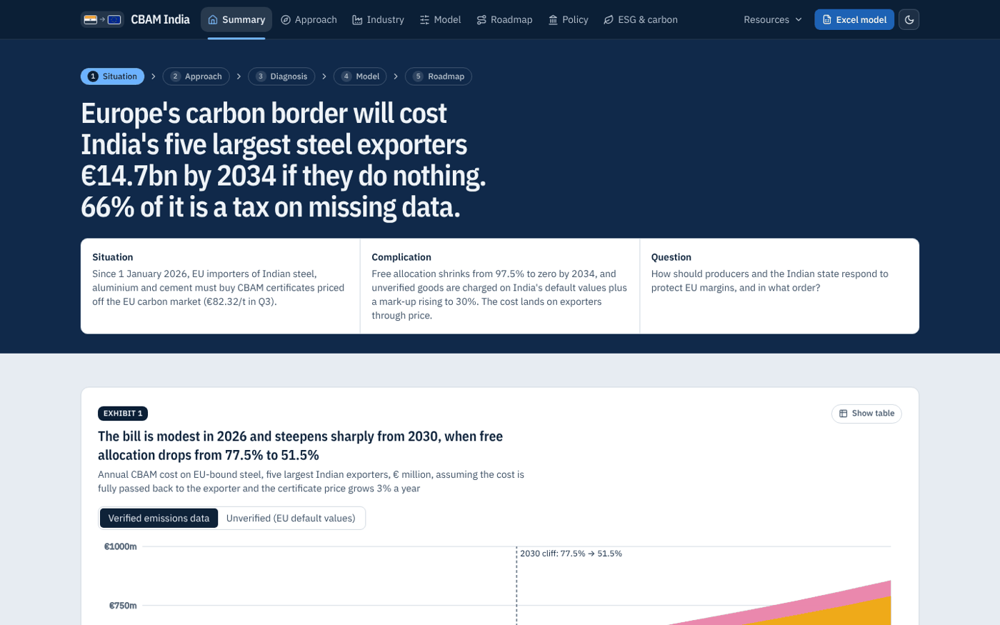</a>

</div>

> **The answer in one line:** Europe's carbon border will cost India's five largest steel exporters **€14.7bn** over 2026–2034 if they do nothing, and **66%** of that is a tax on missing data. Verified emissions, cleaner plant routing and a creditable Indian carbon price cut the bill to **€2.8bn**.

## About

**CBAM India** is an independent, consulting-style analysis of how the EU Carbon Border Adjustment Mechanism affects Indian industry. It is written for four audiences:
- **steel, aluminium and cement exporters** deciding where to invest;
- **EU buyers** pricing CBAM into contracts;
- **Indian policymakers** weighing Article 9 and the Carbon Credit Trading Scheme;
- **ESG and sustainability teams** who need the numbers behind the narrative.

It pairs a tested model of the regulation with the exhibits a client would expect: a scorecard, a Marimekko, a risk matrix, an abatement cost curve, a value-at-stake waterfall, a roadmap and an ESG scorecard.

| | |
|---|---|
| **Author** | [Shreshtha](https://github.com/nightraven4545) |
| **Published** | 31 October 2026 (data as of Q3 2026 CBAM certificate prices) |
| **Live site** | [cbam-india.vercel.app](https://cbam-india.vercel.app) |
| **Coverage** | Steel (JSW, Tata Steel, AM/NS India, JSPL, SAIL), aluminium (Vedanta, Hindalco, NALCO), cement (UltraTech, Shree, Dalmia), downstream MSME goods |
| **Regulation** | Regulation (EU) 2023/956; Implementing Regulations 2025/2620, 2025/2621 and 2026/1740; proposals COM(2025) 989 and COM(2026) 616 |
| **Cite** | See [`CITATION.cff`](CITATION.cff), or use GitHub's "Cite this repository" button |

<table>
<tr>
<td width="38%"><a href="https://cbam-india.vercel.app/CBAM-India-one-pager.pdf">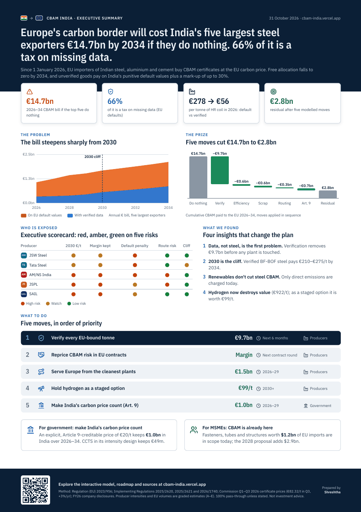</a></td>
<td><b>The one-page executive summary (A4 PDF)</b><br><br>
The whole story on one page:
<ul>
<li>the cost and the 2030 cliff;</li>
<li>the value at stake;</li>
<li>a red, amber and green scorecard for the five exporters;</li>
<li>four insights and five prioritised moves;</li>
<li>what it means for government and MSMEs.</li>
</ul>
Print-ready, with a QR code back to the live model.<br><br>
<a href="https://cbam-india.vercel.app/CBAM-India-one-pager.pdf"><b>Download the PDF →</b></a></td>
</tr>
</table>

## Why it matters now

- **CBAM is live.** Since 1 January 2026, EU importers of Indian steel, aluminium and cement must buy CBAM certificates priced off the EU carbon market (€82.32/t in Q3 2026).
- **The cost has a cliff.** Free allocation falls from 97.5% to zero by 2034. The steepest step is **2030**, when it drops from 77.5% to 51.5%.
- **India is penalised for missing data.** Unverified goods are charged on India's default value of 4.28 tCO₂/t plus a mark-up rising to 30%. A tonne of Tata Steel hot-rolled coil costs **€278** in CBAM on defaults but **€56** with verified data.

## What the analysis shows

<table>
<tr>
<td width="50%"><a href="https://cbam-india.vercel.app/#exhibit-2">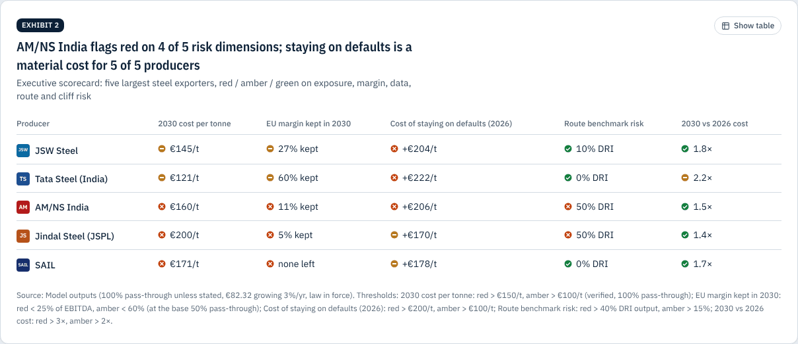</a><br><b>Executive scorecard.</b> Five exporters rated on five risks; AM/NS India flags red on four.</td>
<td width="50%"><a href="https://cbam-india.vercel.app/industry#exhibit-2">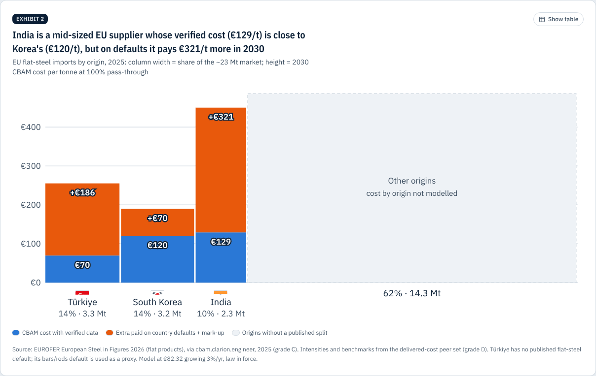</a><br><b>Where India sits in Europe.</b> India's verified 2030 cost (€129/t) is close to Korea's (€120/t); on defaults it pays €321/t more.</td>
</tr>
<tr>
<td><a href="https://cbam-india.vercel.app/industry#exhibit-3">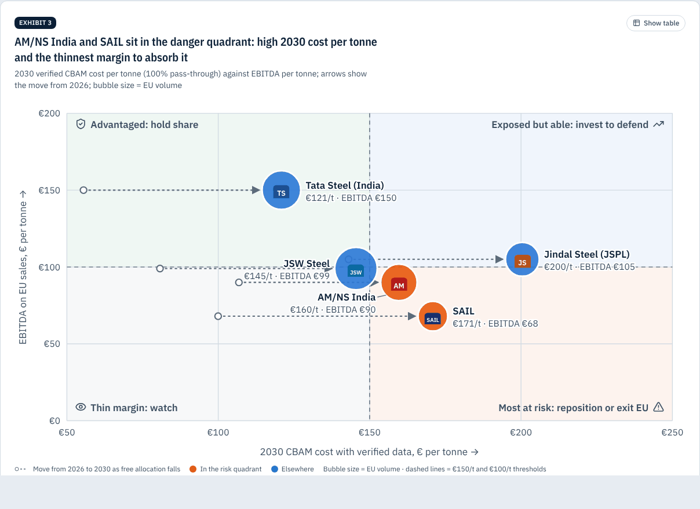</a><br><b>Who is most at risk.</b> 2030 cost per tonne against margin, with each producer's move from 2026.</td>
<td><a href="https://cbam-india.vercel.app/roadmap#exhibit-1">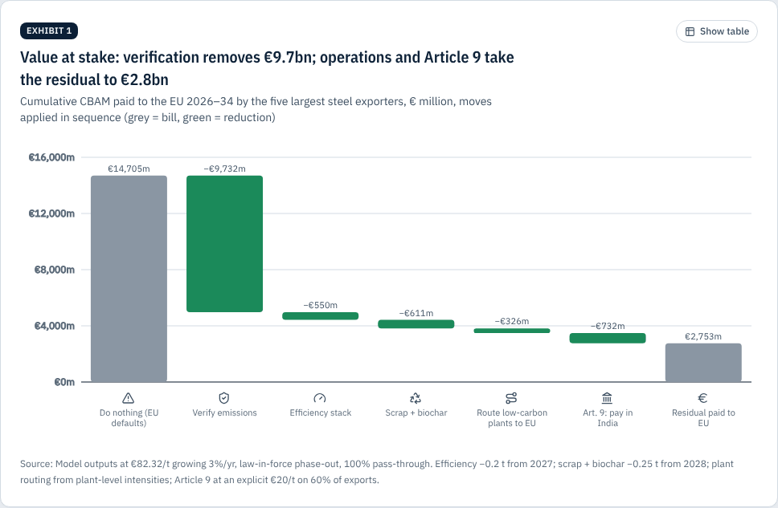</a><br><b>Value at stake.</b> Five moves take the bill from €14.7bn to €2.8bn; verification alone removes €9.7bn.</td>
</tr>
<tr>
<td><a href="https://cbam-india.vercel.app/model">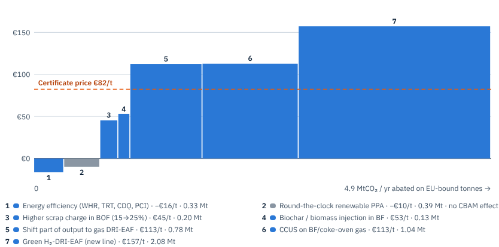</a><br><b>Abatement cost curve.</b> Which levers beat the certificate price, and which cut real emissions but not the CBAM bill.</td>
<td><a href="https://cbam-india.vercel.app/roadmap#exhibit-4">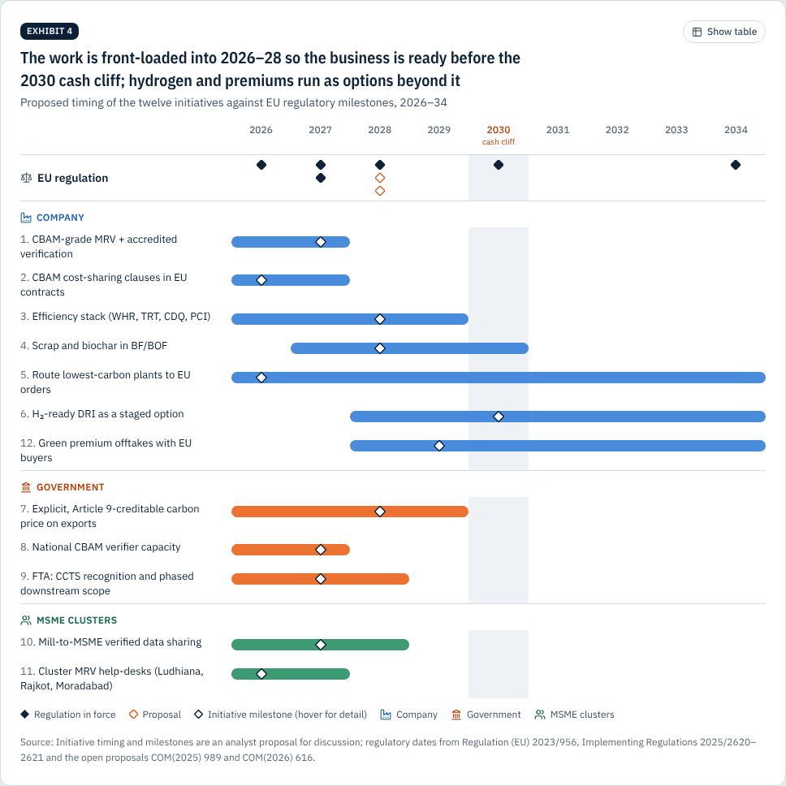</a><br><b>Roadmap.</b> Twelve initiatives timed against EU milestones, front-loaded before the 2030 cliff.</td>
</tr>
<tr>
<td><a href="https://cbam-india.vercel.app/policy#exhibit-2">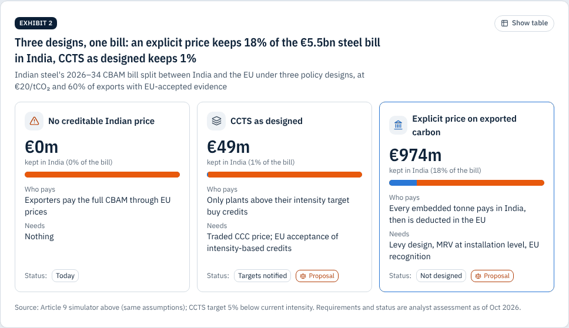</a><br><b>Policy options.</b> An explicit €20/t Indian price keeps €1.0bn at home; CCTS as designed keeps €49m.</td>
<td><a href="https://cbam-india.vercel.app/esg#exhibit-4">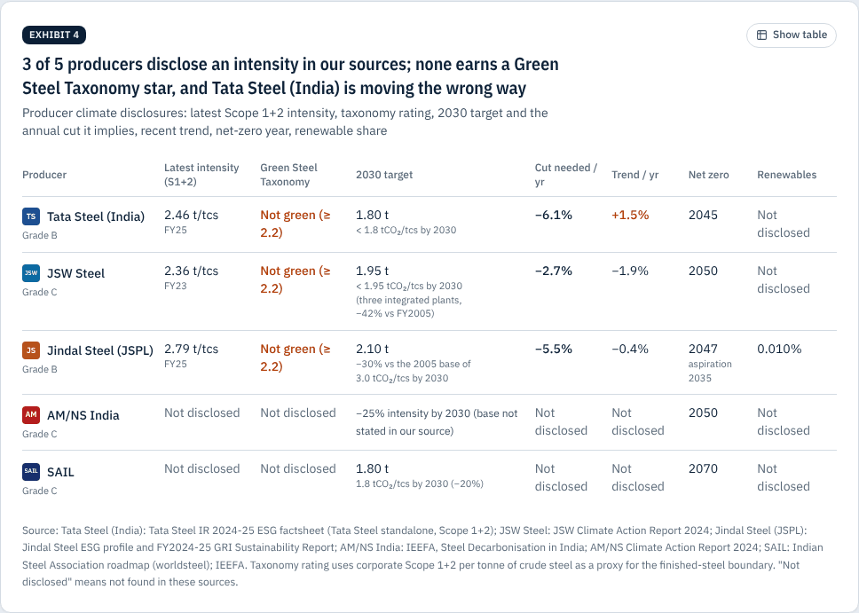</a><br><b>ESG reality check.</b> No disclosing producer meets India's own 2.2 t green-steel threshold.</td>
</tr>
</table>

<details>
<summary><b>More views:</b> recommendations, carbon-price ladder, allocation cliff, issue tree, model, mobile and dark mode</summary>

| | |
|---|---|
| 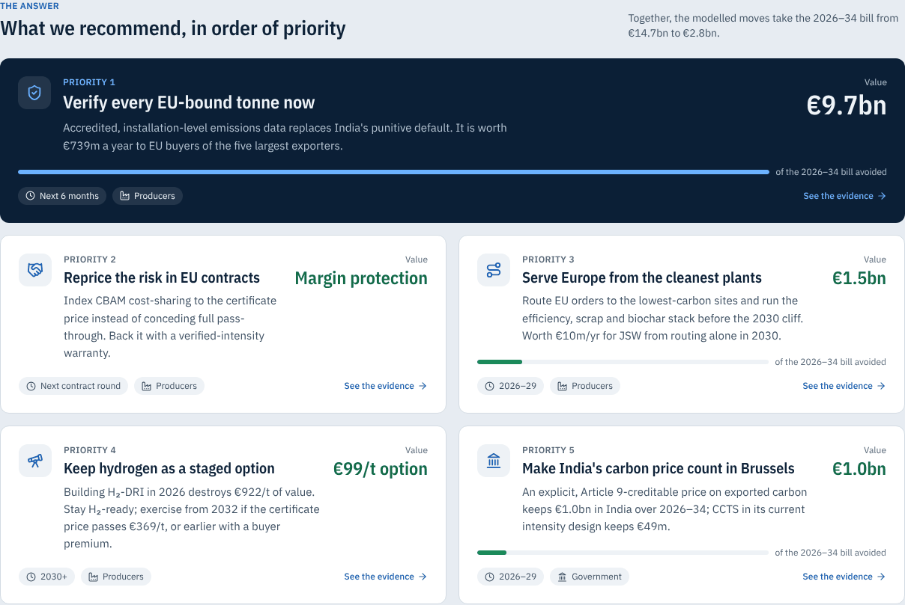 | 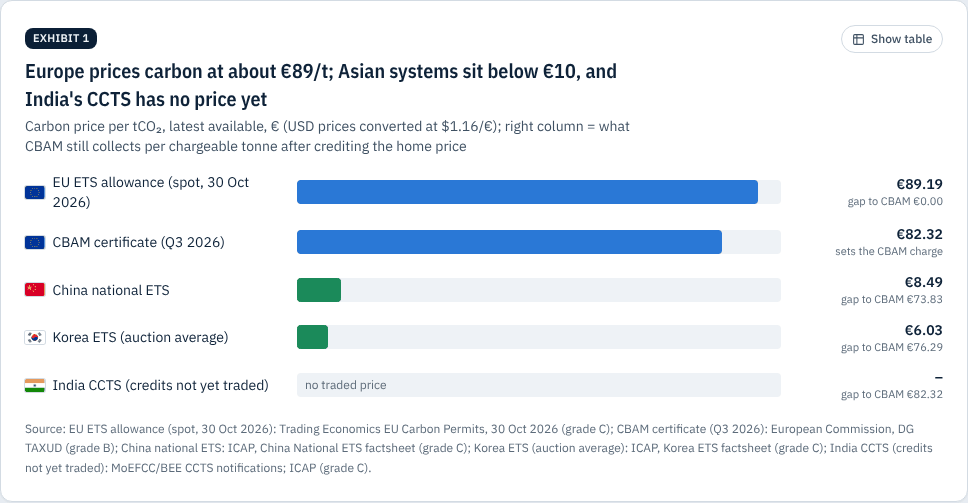 |
| 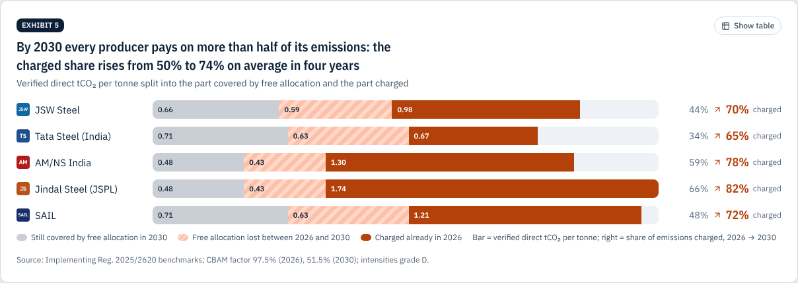 | 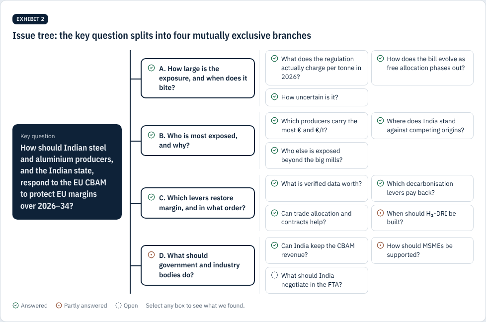 |
| 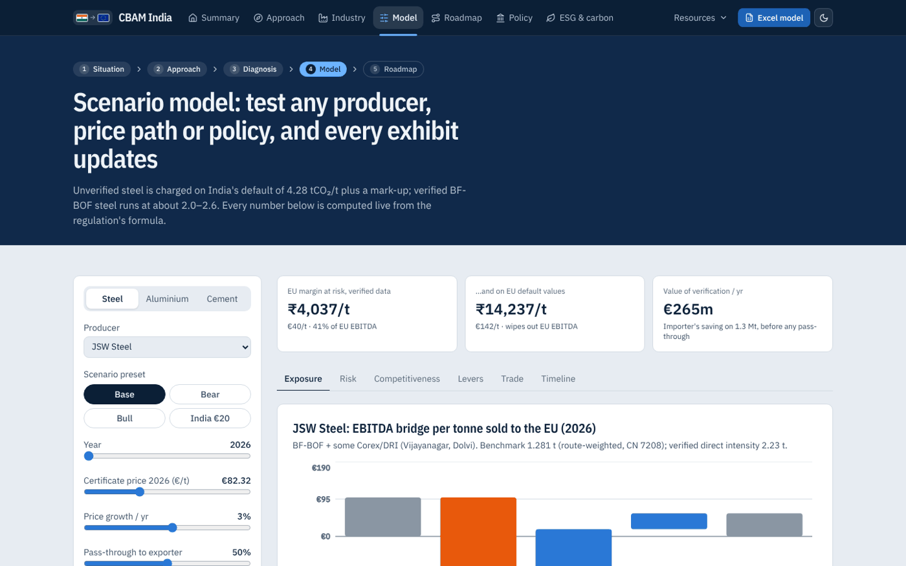 | 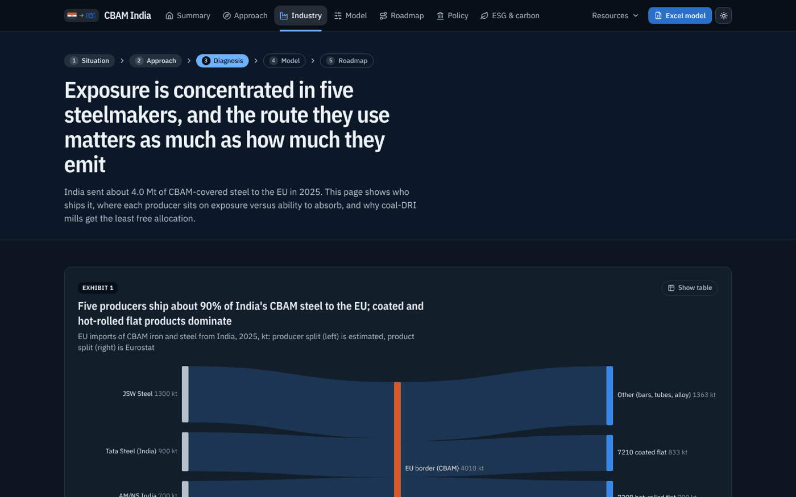 |

<p align="center">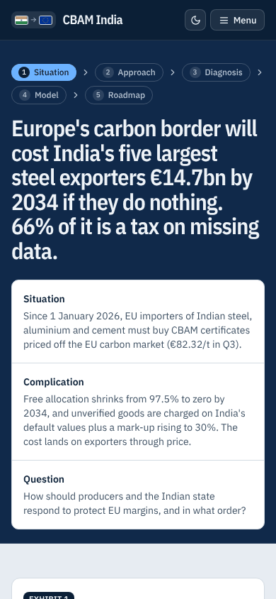</p>
</details>

## What's inside

| Page | The question it answers |
|---|---|
| [**Summary**](https://cbam-india.vercel.app) | What is the answer? The 2030 cash cliff, executive scorecard, value at stake, five recommendations and quick answers |
| [**Approach**](https://cbam-india.vercel.app/approach) | How did we get there? Workflow, interactive issue tree, eight hypotheses tested, six-week plan |
| [**Industry**](https://cbam-india.vercel.app/industry) | Who is exposed, and why? Flows, Mekko of EU imports, risk matrix, route mix, allocation cliff, heatmap, scenario ranges |
| [**Model**](https://cbam-india.vercel.app/model) | What if? Live calculator for 11 producers: driver tree, Monte Carlo risk, crossover vs Türkiye, Korea, China and EU mills, abatement curve, trade allocation, H₂ real option |
| [**Roadmap**](https://cbam-india.vercel.app/roadmap) | What do we do, when, and who owns it? Waterfall, prioritisation, lever assessment, 2026–34 Gantt, KPIs |
| [**Policy & MSMEs**](https://cbam-india.vercel.app/policy) | What should government do? Article 9 simulator, policy designs, downstream radar, MSME hub exposure, per-unit calculator |
| [**ESG & carbon**](https://cbam-india.vercel.app/esg) | How does this look through an ESG lens? Price ladder, disclosure frameworks, producer scorecard, net-zero paths, greenwashing tests |
| [Deck](https://cbam-india.vercel.app/deck) · [Case study](https://cbam-india.vercel.app/case-study) · [Methodology](https://cbam-india.vercel.app/methodology) · [Sources](https://cbam-india.vercel.app/sources) | Presentation mode, a three-minute write-up, the formula and every graded source |

## Quick answers

These answers are generated from the model (`src/lib/faq.ts`). A test fails if this README drifts from it.

### How much will EU CBAM cost Indian steel exporters?
The five largest Indian steel exporters (JSW Steel, Tata Steel, AM/NS India, Jindal Steel and SAIL) face about €14.7bn of CBAM cost on EU sales over 2026–2034 if they stay on EU default values, and about €2.8bn after verification, efficiency, scrap, plant routing and an Indian carbon price. The cost steepens from 2030, when free allocation falls from 77.5% to 51.5%.

### What is India's CBAM default value for hot-rolled steel?
4.28 tCO₂ per tonne for CN 7208 (and 7209/7210), set by Implementing Regulation (EU) 2026/1740, plus a mark-up of 10% in 2026, 20% in 2027 and 30% from 2028. Verified BF-BOF steel runs at roughly 2.0–2.6 t, so defaults overcharge most Indian mills.

### Is verified emissions data worth it for Indian exporters?
Yes. On a tonne of Tata Steel hot-rolled coil in 2026, CBAM is €278 on default values but €56 with verified data. Across the five largest exporters, verification is worth €739m a year to EU buyers and removes 66% of the 2026–34 bill.

### How does India compare with Korea and Türkiye under CBAM?
With verified data, India's 2030 CBAM cost on hot-rolled coil (€129/t) is close to South Korea's (€120/t). On default values India pays €321/t more, the largest default penalty of the major suppliers to the EU.

### Do renewables reduce CBAM on Indian steel and aluminium?
Not today. Iron, steel and aluminium are charged on direct emissions only (Annex II of Regulation (EU) 2023/956), so a renewable power contract cuts the real footprint but not the CBAM bill. Cement is different: its indirect emissions are charged, so renewables and waste-heat recovery reduce cement CBAM.

### Can India keep CBAM revenue at home through its carbon market?
Article 9 lets EU importers deduct a carbon price effectively paid in India. An explicit price of €20/t on every exported tonne would keep about €1.0bn in India over 2026–34; the Carbon Credit Trading Scheme as designed (an intensity scheme) would keep only about €49m. The EU has not yet recognised any third-country price.

### Which Indian MSME exports are already covered by CBAM?
Screws, bolts and nuts, tubes and pipes, structures and other articles of iron, steel and aluminium are already in scope: about $1.2bn of 2024 EU imports from India. The 2028 downstream proposal would add about $2.9bn more, mainly vehicle parts, transmission shafts, valves and machinery parts.

### Does any Indian steelmaker qualify as green steel?
Not among those that disclose an intensity. India's Green Steel Taxonomy (Ministry of Steel, Dec 2024) sets 2.2 tCO₂e per tonne as the green threshold; the disclosed Scope 1+2 intensities are Tata Steel (India) 2.46, JSW Steel 2.36, Jindal Steel (JSPL) 2.79.

## How the model works

```
certificates per tonne = max(0, E − F_t × B)          E = verified or default (+ mark-up) emissions
CBAM € per tonne       = certificates × P − Article 9 credit
exporter's hit         = CBAM € per tonne × pass-through × EU volume
```

- **F_t**, the CBAM factor: 97.5% (2026), 95%, 90%, 77.5%, **51.5% (2030)**, 39%, 26.5%, 14%, 0% (2034). The COM(2026) 616 proposal is available as a toggle.
- **B**, the route-weighted benchmark: hot-rolled BF-BOF 1.370, DRI-EAF 0.481 and scrap-EAF 0.072 t (Implementing Regulation (EU) 2025/2620).
- **P**, the certificate price: Commission quarterly prices for 2026, then a scenario path, plus a seeded mean-reverting Monte Carlo.
- **Scope:** steel and aluminium are charged on direct emissions only; cement includes electricity.
- **Testing and traceability:**
  - every quoted number on the site is computed, never typed;
  - 49 unit tests cover the Commission worked example, the optimiser against brute force, Mekko and MACC geometry, the driver tree, ESG maths, the policy helpers and this README;
  - every input carries a source and a confidence grade (A–E), listed on [/sources](https://cbam-india.vercel.app/sources).

## Run it locally

```bash
npm install
```

```bash
npm test
```

```bash
npm run dev
```

**Stack:**
- Next.js 15 (App Router, static), React 19, TypeScript, Tailwind CSS v4;
- Recharts plus custom SVG for the consulting exhibits;
- lucide icons and country-flag-icons;
- ExcelJS for the downloadable model;
- Vitest and Playwright, with axe-core for accessibility.

**Structure:**
- `src/lib/`: the engine (`cbam.ts` rules, `model.ts` scenarios, `risk.ts` Monte Carlo, `policy.ts`, `options.ts`, `exhibits.ts`, `esg.ts`, `storyline.ts`, `faq.ts`), each with tests.
- `src/components/`: exhibits, charts, indicators and the interactive model.
- `src/app/`: one folder per page, plus `sitemap.xml`, `robots.txt` and `llms.txt`.

## For search engines and AI assistants

- [`/llms.txt`](https://cbam-india.vercel.app/llms.txt) gives a plain-text guide to every page and the key answers, generated from the model.
- Structured data on every page: schema.org `WebSite` and `Report`, plus `FAQPage` on the summary.
- Citation metadata is in [`CITATION.cff`](CITATION.cff).

## Caveats

- Producer intensities and some volumes are analyst estimates (grade D). Replace them with verified installation data before relying on any single number.
- Company logos are trademarks of their owners, used for identification only.
- This is not investment advice.

---

<sub>Prepared by <a href="https://github.com/nightraven4545">Shreshtha</a>, 31 October 2026. Keywords: CBAM India, EU carbon border adjustment mechanism, CBAM cost calculator, CBAM default values India, Indian steel exports to EU, Tata Steel, JSW Steel, AM/NS India, Jindal Steel, SAIL, Vedanta, Hindalco, aluminium, cement, EU ETS, Article 9, CCTS, green steel taxonomy, decarbonisation roadmap.</sub>
